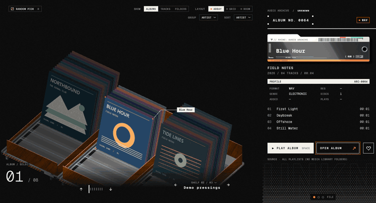
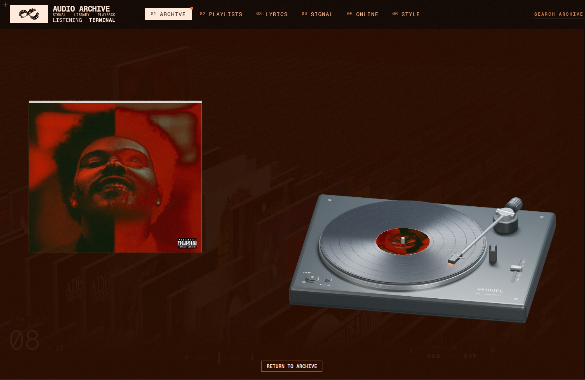
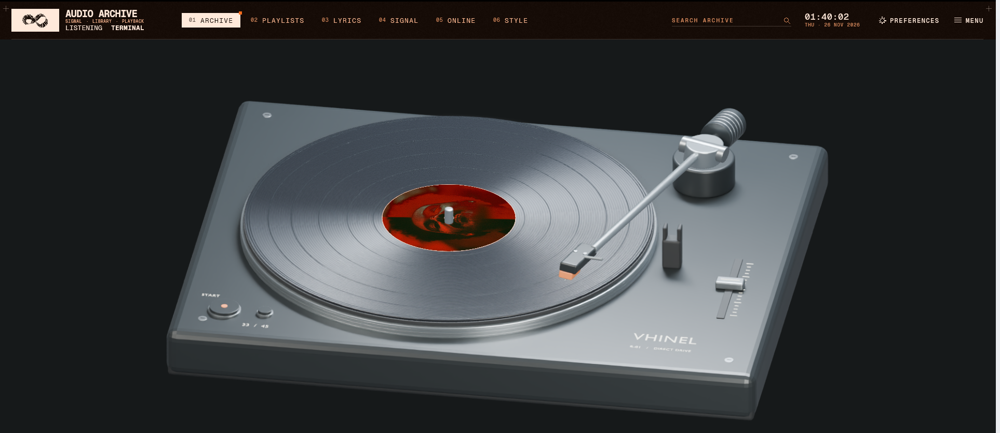

# VHINEL

**A vinyl record archive and interactive turntable for foobar2000.**

VHINEL is a fork of [RhinE](https://github.com/ericzhang12111-cell/RhinE) that turns its CD-style archive into shelves of vinyl jackets. Pick an album, pull the record from its sleeve, and drop it onto the platter. foobar2000 starts playback as the stylus lands.

[Install VHINEL](#install-vhinel) · [Controls and settings](GUIDE.md) · [Blender assets and build notes](authoring/vinyl/INTEGRATION.md)

## What's new in VHINEL

| Feature | What changed |
| --- | --- |
| **Vinyl Archive** | Use the wheel or `↑` and `↓` to flip through records in Array. Each jacket pivots from its bottom edge onto the pile in front. Reverse direction to return it. Click an exposed sleeve or spine to select it. The previous crate stays visible and clickable on the right. The Room view also uses vinyl jackets, and Cover Grid is available for browsing by artwork. |
| **Sleeve backs** | Array gives each jacket visible thickness and its own edge colors. Original back scans take precedence. Generated backs use colors from the front cover and show up to 12 tracks in two columns, with a count of any omitted tracks. |
| **Interactive turntable** | Open an LP in Array or Room, pull the record out by its rim, and drop it onto the platter. The disc tilts into place and playback starts when the stylus lands. A partial pull or missed drop returns the record to the sleeve. |
| **Now Spinning** | Open the dedicated view from the transport bar. The playing sleeve lies behind the turntable. Right-click to choose **Wood** or **Plain** and scroll or use `+` and `-` to zoom. Click **Fullscreen**, double-click the deck, or press `F11` to fill the screen. `Esc` exits fullscreen and then returns to the previous view. Array and Room can open it after 30 seconds of inactivity and dismiss it on mouse movement. |
| **Playback animation** | Album artwork becomes the rotating center label, with a VHINEL label as fallback. The disc makes one turn in about 3.6 seconds and holds its position when paused. The tonearm follows album progress when album duration is available, or track progress otherwise. |
| **Editable playback queue** | Open `QUEUE` in the player bar to see upcoming tracks. Drag rows to reorder them, or use the row menu to move or remove an entry. The player bar shows the queue count. |
| **Add to queue** | In Archive, drag a cover or track row to the right and release when `ADD TO QUEUE` appears. In Playlists, select tracks and click or swipe right on the header's `ADD TO QUEUE` button, or drop the selection onto the right-hand panel. |
| **Copy tracks between playlists** | Use `Add to playlist` beside `LAYOUT`, drag selected tracks onto a destination playlist, or right-click the destination and choose `Add selected tracks here`. Tracks already in the destination are skipped. |

The fork also includes the editable Blender scene, rendered jackets and turntable layers, export and verification scripts, and an [interaction preview](authoring/vinyl/proofs/interaction.mp4).

## Play a record

### 1. Browse and select an LP

Open **Archive → Array** and flip through the crate with the mouse wheel or the up and down arrows. Select a jacket, then click it again or press `Enter` to inspect it. You can also inspect a jacket from **Room**.

### 2. Pull the record by its rim

Grab the exposed rim and drag the record out of the sleeve.

### 3. Drop the record onto the platter

Drag the record over the platter and release it.

### 4. Listen as the stylus lands

The record settles onto the platter, the tonearm lowers, and foobar2000 starts playback. Click **Return to Archive** or press `Esc` to browse again.

### 5. Open Now Spinning

During playback, open **Now Spinning** from the transport bar next to **Queue**. Click **Fullscreen**, double-click the turntable, or press `F11` to fill the screen. Press `Esc` to leave fullscreen.

## Install VHINEL

**Requirements:** Windows 10 or 11 (64-bit), foobar2000 v2 (64-bit), [Columns UI](https://github.com/reupen/columns_ui/releases), and [JSplitter](https://github.com/dima-lur/jsplitter/releases).

### Update a portable RhinE installation

1. Download this repository via **Code → Download ZIP** and extract it. Keep all the `VHINEL-foobar-update.zip.*` parts together in [`authoring/vinyl`](authoring/vinyl).
2. Close foobar2000. Open `VHINEL-foobar-update.zip.001` in [7-Zip](https://www.7-zip.org/).
3. Extract into the portable player's `foobar2000\profile` folder. Merge the `themes` folder and replace matching files so the update lands in `foobar2000\profile\themes\audio-archive`.
4. Start foobar2000 and open **Archive → Array** or **Room**.

### Install from this repository

With the repository extracted, run [`theme/install.cmd`](theme/install.cmd). If you have multiple foobar2000 installations, select the one you want to use. The installer can add Columns UI and JSplitter if needed. In foobar2000, add your music through **Preferences → Media Library**.

For future VHINEL updates, use this repository's files. The inherited in-app updater checks upstream RhinE releases.

## Upstream features and credits

VHINEL is based on [RhinE 2.3.0](https://github.com/ericzhang12111-cell/RhinE/tree/v2.3.0). It inherits library browsing, artist files, the playlist manager, synced lyrics, Signal and Classic visualizers, online music integration, and appearance settings. See the [user guide](GUIDE.md) and [upstream changelog](CHANGELOG.md).

Thanks to the RhinE authors and contributors and to the developers of foobar2000, Columns UI, JSplitter, and Blender. See [full credits](GUIDE.md#credits-and-licence). The theme is distributed under the [MIT License](LICENSE).
