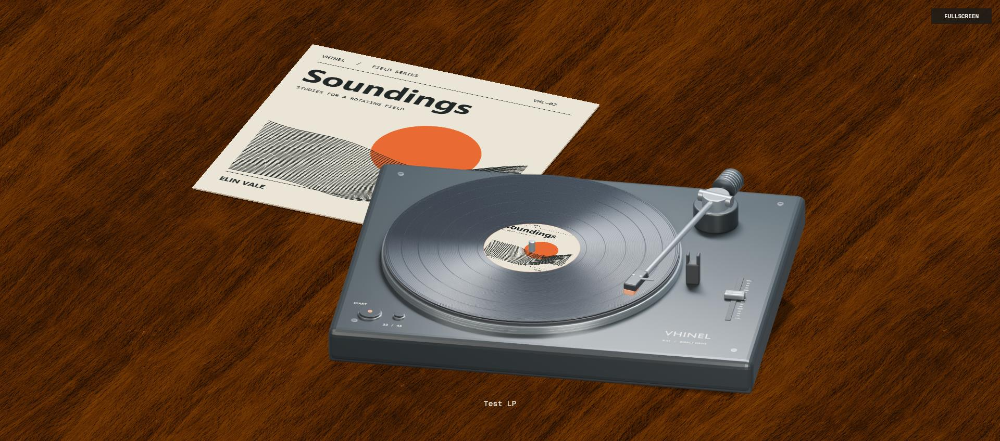
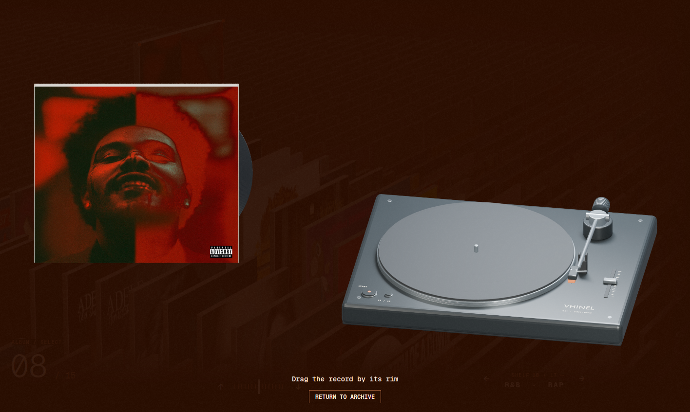
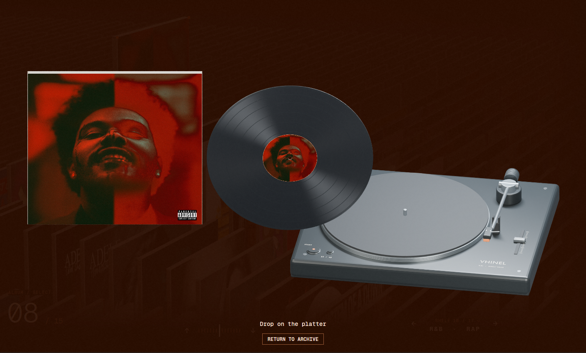

# VHINEL

**A vinyl record archive and interactive turntable for foobar2000.**

VHINEL is a fork of [RhinE](https://github.com/ericzhang12111-cell/RhinE) that turns its CD-style archive into shelves of vinyl jackets. Pick an album, pull the record from its sleeve, and drop it onto the platter. foobar2000 starts playback as the stylus lands.

[Install VHINEL](#install-vhinel) · [Controls and settings](GUIDE.md) · [Blender assets and build notes](authoring/vinyl/INTEGRATION.md)

## What's new in VHINEL

| Feature | What changed |
| --- | --- |
| **Vinyl Archive** | Browse Array like a record bin. Each step tips a jacket onto the front stack and reveals the next cover. Scroll back to flip it into place. Click an exposed sleeve to select it. Room and Cover Grid are also available. |
| **Sleeve backs** | Jackets have visible edges as they turn. Array shows original back scans when available and generates color-matched backs with two columns of track titles for the rest. The previous crate stays visible and clickable on the right. |
| **Interactive turntable** | Jacket inspection reveals the record rim. Drag it out, carry it to the deck, and release it over the platter. The record tilts into place, the tonearm lowers, and playback starts on contact. A partial pull or missed drop returns the record to the sleeve. |
| **Now Spinning** | The playing LP sleeve lies behind the deck. Right-click for Wood or Plain, scroll to zoom, and click **Fullscreen** or double-click the deck to fill the monitor. `Esc` leaves fullscreen, then returns to the player. The optional idle view opens after 30 seconds and closes on mouse movement. |
| **Playback animation** | Album artwork becomes the rotating center label, with a VHINEL label as fallback. The disc makes one turn in about 3.6 seconds and holds its position when paused. The tonearm follows album progress when album duration is available, or track progress otherwise. |
| **Editable playback queue** | Open `QUEUE` in the player bar to see upcoming tracks. Drag rows to reorder them, or use the row menu to move or remove an entry. The player bar shows the queue count. |
| **Add to queue** | In Archive, drag a cover or track row to the right and release when `ADD TO QUEUE` appears. In Playlists, select tracks and click or swipe right on the header's `ADD TO QUEUE` button, or drop the selection onto the right-hand panel. |
| **Copy tracks between playlists** | Use `Add to playlist` beside `LAYOUT`, drag selected tracks onto a destination playlist, or right-click the destination and choose `Add selected tracks here`. Tracks already in the destination are skipped. |

The fork also includes the editable Blender scene, rendered jackets and turntable layers, export and verification scripts, and an [interaction preview](authoring/vinyl/proofs/interaction.mp4).

## Play a record

### 1. Pull the record by its rim

Open **Archive** and choose **Array** or **Room**. Select a jacket, then click it again or press `Enter` to inspect it. Grab the exposed rim and drag the record out of the sleeve.

### 2. Drop the record onto the platter

Drag the record over the platter and release it.

### 3. Listen as the stylus lands

The record settles onto the platter, the tonearm lowers, and foobar2000 starts playback. Click **Return to Archive** or press `Esc` to browse again.

### 4. Open the fullscreen turntable

During playback, open **Now Spinning** from the transport bar next to **Queue**. Click **Fullscreen** or double-click the turntable. Press `Esc` to leave fullscreen.

## Install VHINEL

**Requirements:** Windows 10 or 11 (64-bit), foobar2000 v2 (64-bit), [Columns UI](https://github.com/reupen/columns_ui/releases), and [JSplitter](https://github.com/dima-lur/jsplitter/releases).

### Update a portable RhinE installation

1. Download this repository via **Code → Download ZIP** and extract it. Keep all the `VHINEL-foobar-update.zip.*` parts together in [`authoring/vinyl`](authoring/vinyl).
2. Close foobar2000. Open `VHINEL-foobar-update.zip.001` in [7-Zip](https://www.7-zip.org/).
3. Extract into the portable player's `foobar2000\profile` folder. Merge the `themes` folder and replace matching files so the update lands in `foobar2000\profile\themes\audio-archive`.
4. Start foobar2000 and open **Archive → Array** or **Room**.

### Install from this repository

With the repository extracted, run [`theme/install.cmd`](theme/install.cmd). If you have multiple foobar2000 installations, select the one you want to use. The installer can add Columns UI and JSplitter if needed. In foobar2000, add your music through **Preferences → Media Library**.

For future VHINEL updates, use this repository's files. The inherited in-app updater checks upstream RhinE releases.

## Upstream features and credits

VHINEL is based on [RhinE 2.3.0](https://github.com/ericzhang12111-cell/RhinE/tree/v2.3.0). It inherits library browsing, artist files, the playlist manager, synced lyrics, Signal and Classic visualizers, online music integration, and appearance settings. See the [user guide](GUIDE.md) and [upstream changelog](CHANGELOG.md).

Thanks to the RhinE authors and contributors and to the developers of foobar2000, Columns UI, JSplitter, and Blender. See [full credits](GUIDE.md#credits-and-licence). The theme is distributed under the [MIT License](LICENSE).
